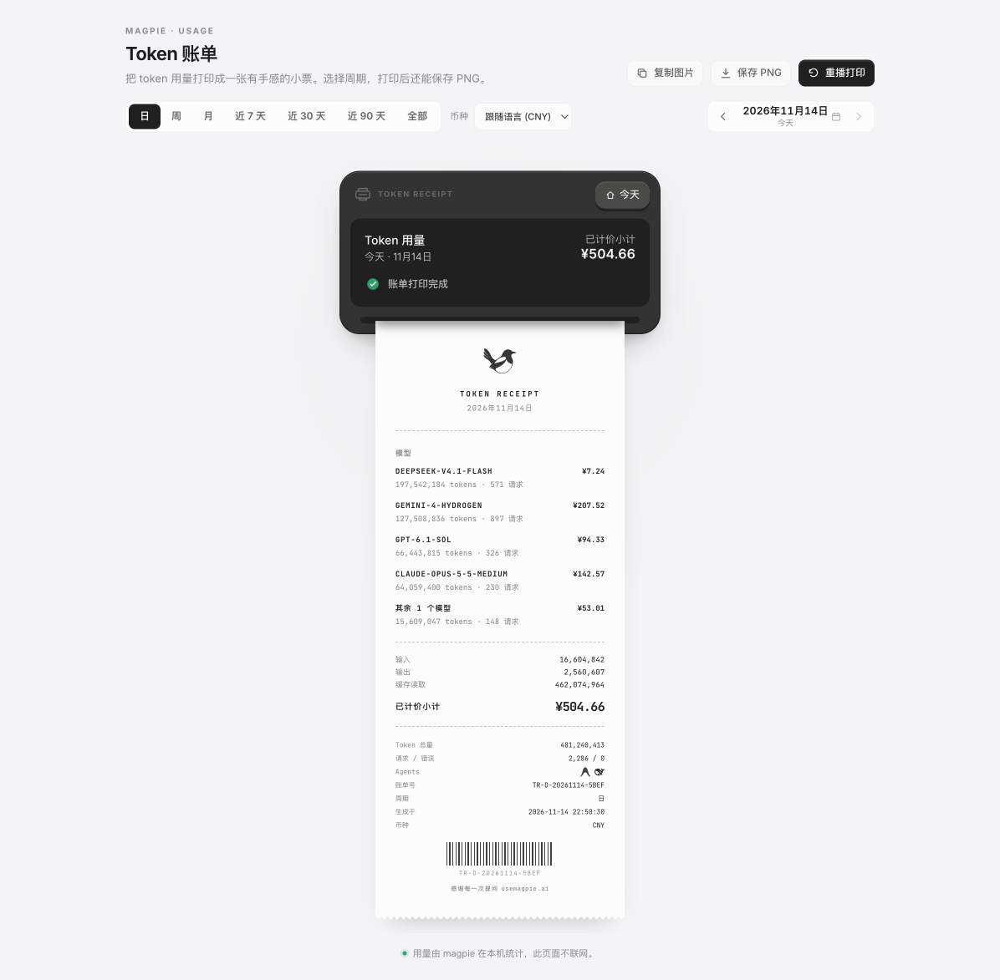
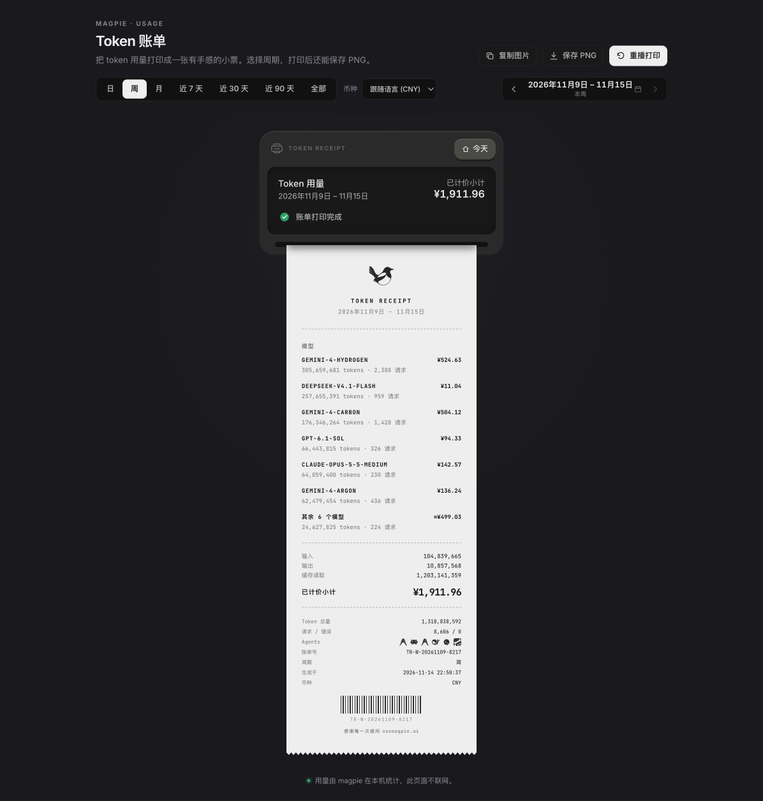

<div align="center">
  
  <h1>トークン明細</h1>
  <p><a href="https://usemagpie.ai">magpie</a> のページプラグイン。日次・週次・月次・直近 7 / 30 / 90 日・全期間のトークン使用量と料金を、手触りのあるレシートとして印刷します。</p>
  <p><a href="README.md">English</a> · <a href="README.zh.md">简体中文</a> · <strong>日本語</strong></p>
</div>

| ライト · 日次明細 | ダーク · 週次明細 |
| :---: | :---: |
|  |  |

## 主な機能

- **7 つの期間。** 日・週（月曜始まり）・月・直近 7 日・直近 30 日・直近 90 日・全期間。前後の期間への移動、日付の選択、今日へのジャンプができます。
- **モデル別の料金。** 複数のエージェントやプロバイダーを経由した同じモデルは 1 行にまとめます。入力・出力・キャッシュ読込・キャッシュ書込はトークン数で表示します。
- **複数通貨。** 表示言語に合わせるか、`USD`・`CNY`・`JPY` を選べます。CNY は magpie の設定のレートを使います。
- **レシートプリンター演出。** ステップ紙送り、切り口、バーコード。視差効果を減らす設定ではアニメーションを省きます。
- **保存とコピー。** 3 倍解像度の PNG を「ダウンロード」に保存、またはクリップボードにコピーします。
- **多言語とテーマ。** 日本語・English・简体中文・繁體中文、magpie のライト／ダークテーマに対応します。

> [!NOTE]
> 使用量と料金は、読み取り専用の `usage:day` 権限を通じて magpie の端末内の記録から取得します。ページはネットワークのない magpie のサンドボックス内で動作します。料金が不明な呼び出しがある場合、合計は「計算済み小計」と表示され、未計算の件数が注記されます。

## インストール

magpie で **プラグイン → プラグインを追加** を開いてこのフォルダーのパスを入力するか、次を実行します。

```sh
magpie plugin add /absolute/path/to/magpie-token-receipt
```

サイドバーのプラグインに **トークン明細** が表示されます。

## 開発

```sh
npm run check
npm test
```

## ライセンス

MIT。フォントなどの表記は [THIRD_PARTY_NOTICES.md](THIRD_PARTY_NOTICES.md) を参照してください。
