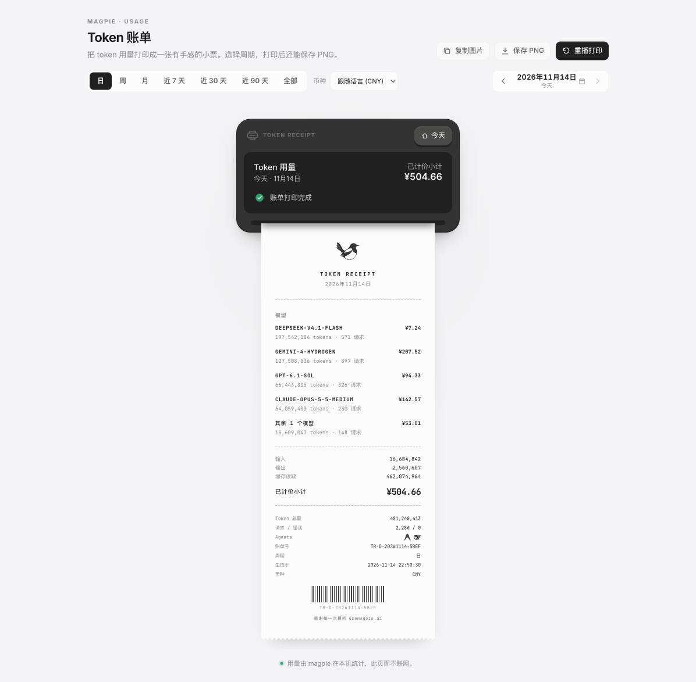
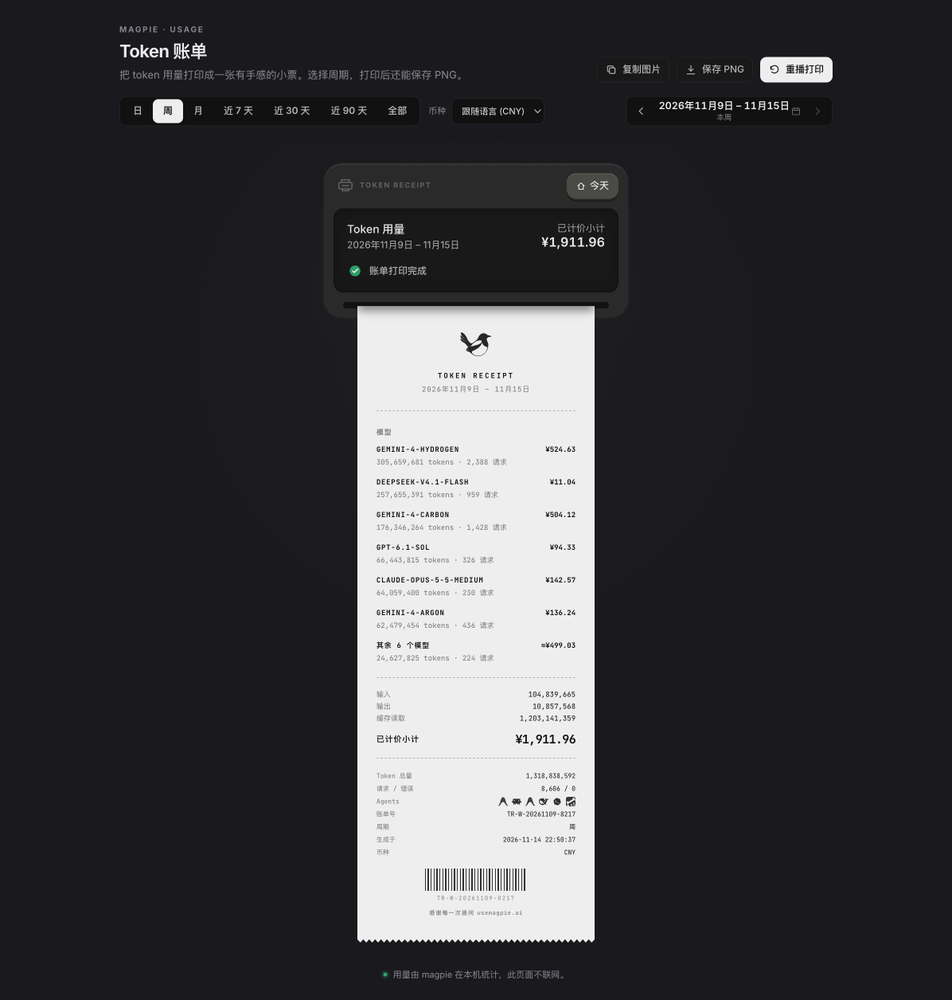

<div align="center">
  
  <h1>Token 账单</h1>
  <p>一个 <a href="https://usemagpie.ai">magpie</a> 页面插件：把日、周、月、最近 7 / 30 / 90 天或全部的 token 用量与费用，打印成一张有手感的小票。</p>
  <p><a href="README.md">English</a> · <strong>简体中文</strong> · <a href="README.ja.md">日本語</a></p>
</div>

| 亮色 · 日账单 | 暗色 · 周账单 |
| :---: | :---: |
|  |  |

## 主要功能

- **七种周期。** 日、周（自然周，周一开始）、月（自然月）、近 7 天、近 30 天、近 90 天，以及从第一条记录到今天的「全部」。可以前后翻页、选日期，也可以一键回到今天。
- **按模型列出费用。** 同一个模型无论经过哪个 Agent、哪个供应商，都合并成一行。另外列出输入、输出、缓存读取、缓存写入的 token 数。
- **多币种。** 默认跟随语言，也可以手动选 `USD`、`CNY`、`JPY`。CNY 使用 magpie 设置里的汇率。
- **小票打印机效果。** 分步送纸、锯齿撕口和条形码；开启「减弱动态效果」后不播放动画。
- **保存与复制。** 生成 3 倍分辨率的 PNG，保存到「下载」文件夹，或者直接复制到剪贴板。
- **多语言与主题。** 支持简体中文、繁體中文、English、日本語，跟随 magpie 窗口的亮色和暗色主题。

> [!NOTE]
> 用量和费用都来自 magpie 在本机的记录，通过插件只读的 `usage:day` 权限读取。页面运行在 magpie 的无网络沙盒里，不会联网。有些调用没有价格，这时合计显示为「已计价小计」，并注明有多少次请求未计价。

## 安装

在 magpie 里打开 **插件 → 添加插件**，填入这个文件夹的路径；或者在终端运行：

```sh
magpie plugin add /absolute/path/to/magpie-token-receipt
```

添加后，侧边栏的「插件」分组里会出现 **Token 账单**。

## 和 dsh-token-receipt 的区别

这个插件从 [dsh-token-receipt](https://github.com/maxlee/dsh-token-receipt) 移植而来。受 magpie 页面沙盒的限制，有几处不同：

| dsh-token-receipt | 本插件 |
| --- | --- |
| 打印 / PDF | 复制图片（沙盒里不能打开打印对话框） |
| 输入、输出、缓存分别计费 | 这几行显示 token 数；magpie 只提供每个模型的总费用 |
| 请求 / 会话 | 请求 / 错误，另加一行 Agents，显示用到的每个 Agent 的黑白图标 |
| 从 models.dev 拉取价格 | 直接使用 magpie 算好的费用 |

## 开发

```sh
npm run check   # 检查所有脚本的语法
npm test        # node --test
```

- `page/model.js`：周期、`usage:day` 参数、模型合并、金额和账单号，全部是纯函数，测试直接加载它。
- `page/view.js`：一个很小的 `h()` 加原地 patch，渲染打印机和小票。
- `page/export.js`：把屏幕上的小票按 DOM 逐个画到 canvas 上，生成 PNG。
- `page/app.js`：主题、选项、数据读取和打印状态机。

修改后，在 magpie 的「插件」里把它关掉再打开，就会加载新代码；在 `magpie web` 里刷新页面即可。

## 许可

MIT。字体和第三方说明见 [THIRD_PARTY_NOTICES.md](THIRD_PARTY_NOTICES.md)。
